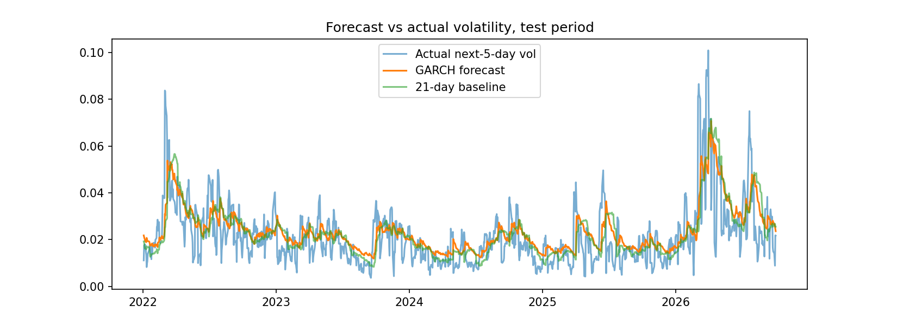

# Forecasting Brent Crude Volatility and Backtesting Value-at-Risk

[](https://colab.research.google.com/github/bluecollard181/brent-volatility-var-backtest/blob/main/BrentOilModelling.ipynb)

A Python project that forecasts the volatility of Brent crude oil futures and tests whether better volatility forecasts give a more reliable Value-at-Risk (VaR) estimate. It compares simple baselines, a GARCH(1,1) model and a random forest on 1,195 unseen trading days, then backtests the VaR each one produces.

## Key results

Data: Brent futures (`BZ=F`), 4 January 2010 to 9 October 2026. Models were trained on 2010–2021 and tested on 2022 onwards.

| Model | RMSE | MAE | 95% VaR breaches (≈60 expected) | Kupiec p-value |
|---|---|---|---|---|
| Baseline: last 5 days' volatility | 0.01343 | 0.00932 | n/a | n/a |
| Baseline: last 21 days' volatility | 0.01160 | 0.00818 | 73 (6.1%) | 0.089 |
| Random forest | 0.01190 | 0.00812 | 73 (6.1%) | 0.089 |
| **GARCH(1,1), Student-t** | **0.01094** | **0.00799** | **61 (5.1%)** | **0.869** |

- **GARCH was the most accurate model,** beating the best baseline by about 5.7% on RMSE and 2.3% on MAE.
- **GARCH also gave the most reliable VaR.** Its breach count was almost exactly what a 95% VaR should produce. The baseline and random forest breached about 22% too often, which suggests they understate risk, though not enough to be formally rejected.
- **Volatility is asymmetric.** It is about 14% higher after a big fall than after a big rise (the leverage effect), which standard GARCH cannot capture.
- **Next-month forecast.** GARCH forecasts about 2.3% volatility on an average day (36.7% annualised) and a one-month price-change standard deviation of about 10.6%. This measures the size of likely moves, not their direction.



## Method

1. Download daily closing prices with `yfinance` and calculate log returns.
2. Build features (5-, 21- and 63-day rolling volatility, absolute return, 5-day return) and a target (volatility over the next 5 trading days).
3. Split by date (train to 31 December 2021, test from 2022) and score two simple baselines.
4. Fit GARCH(1,1) with Student-t errors on the training period only, then forecast the test period with fixed parameters.
5. Fit a random forest on the same features, and check feature importance.
6. Convert each forecast into a 95% VaR for a £100,000 position and count how often actual losses exceed it.
7. Test the breach counts with the Kupiec test, and check whether breaches cluster.
8. Refit GARCH on the full history to forecast the next 21 trading days.

## Limitations

- `BZ=F` is a continuous front-month series, so it contains rollover jumps that can inflate volatility estimates.
- The VaR applies a 5-day volatility forecast to a 1-day loss and assumes normal returns, even though the returns have fat tails.
- The 21-day forecast has not been backtested.
- Results come from one train/test split and apply to Brent only. They do not show GARCH is best for other assets.
- Volatility models measure the size of moves, not their direction, so this is not a trading signal.

## Next steps

EWMA, GJR-GARCH and HAR-style models, Student-t and 99% VaR, rollover-adjusted prices, and repeating the analysis on other assets.

## Repository

| File | Contents |
|---|---|
| `BrentOilModelling.ipynb` | Full analysis, with outputs |
| `Brent_Crude_Volatility_and_VaR_Report.pdf` | Written report |
| `images/` | Charts used in the report and README |
| `requirements.txt` | Python dependencies |

## Running it

Click the Colab badge, or run locally:

```bash
pip install -r requirements.txt
jupyter notebook BrentOilModelling.ipynb
```

Data is downloaded live from Yahoo Finance, and the end date is fixed at 10 October 2026 so the results are reproducible.

## Tools

Python, pandas, NumPy, yfinance, arch, scikit-learn, SciPy, matplotlib.
